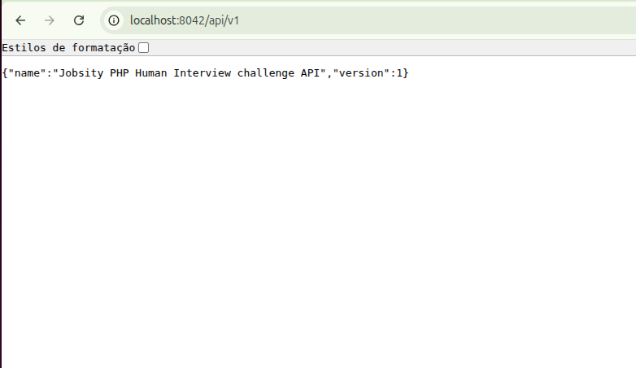
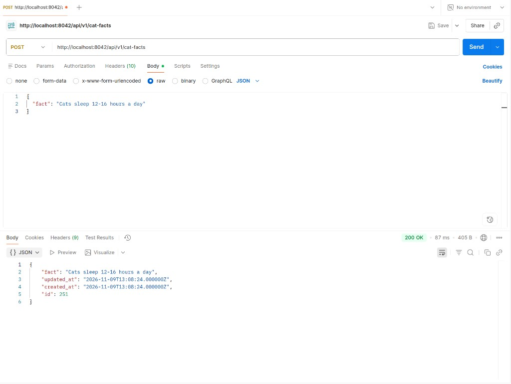

# AI usage log — PHP Human Interview Challenge

> Conversation with the AI was conducted in Portuguese. Prompts below are documented for review (clarified for readability, same intent). Narrative annotations are in English.

## Working model

I used Cursor as an **execution assistant**. I set the goals, reviewed every change, rejected approaches that did not match the brief, and validated the result. The AI drafted/ran commands and generated boilerplate when I instructed it to.

**Tool:** Cursor (Composer / Auto agent)

**I owned:**
- Step order (boot → reproduce bug → fix → Dog Facts → README → `prompt.md`)
- Design choice: mirror Cat Facts; **no** premature Cat/Dog abstraction
- Cat Facts store fix applied by me after Postman reproduction
- Dockerfile comment wording (backend-only rationale)
- README tone/length
- Final review of AI output before accepting it
- Test and HTTP verification

**AI executed (under my direction):** environment commands, code scaffolding for Dog Facts, draft README/`prompt.md` text, lookup/diagnosis support.

**Validation:** `vendor/bin/sail test` (**36 passed**), plus the manual checks documented with screenshots below.

---

## Conversation 1 — Bootstrapping the project

### Prompt
> Estou em um desafio técnico Laravel com Sail. O fluxo pede `vendor/bin/sail up`, mas ainda não tenho `vendor/`. Antes de subir os containers, resolva o `composer install` — há conflito de PHP no host. O enunciado está no PDF; vamos por etapas. Primeiro objetivo: API rodando localmente. Eu reviso cada passo antes de avançar Você sempre fará e eu revisarei para evitarmos erros posteriores.

### AI executed
- Confirmed host PHP **8.5** vs Laravel 9 lock.
- Ran Docker Composer with `--ignore-platform-reqs` (Sail runtime PHP **8.1**).
- First deleted `npm install -g npm` after Sail build failure; I rejected that approach.
- Adjusted `VITE_PORT` when `5173` was busy.
- Brought stack up: `sail up`, `key:generate`, `migrate --seed`.

**My review / decisions:**
- **Rejected** deleting the Sail line; ordered it **commented** instead.
- **Rejected** blaming Node/npm version mismatch as the main comment reason (my machine). Final comment: challenge is **backend-only**, global npm upgrade unnecessary.
- **Accepted** Docker `composer install --ignore-platform-reqs`; kept it in the README.
- After boot, I verified manually in the browser (`http://localhost:8042/api/v1`):

### Follow-up prompts (I dictated the comment)
> Não delete `npm install -g npm`. Comente a linha e explique em inglês ao lado.
>
> No comentário, priorize que o desafio pediu só backend.
>
> Tire a parte de conflito de versão do npm — isso é do meu ambiente. Deixe só: backend-only, upgrade global desnecessário.

---

## Conversation 2 — Cat Facts store bug

### Prompt
> O enunciado aponta erro no store de Cat Facts. Antes de qualquer fix: monte a request do Postman (método, URL, headers, body) e a resposta do bug. Eu reproduzo e só então decido a correção.

### AI executed
- Documented `POST /api/v1/cat-facts` → **403** `This action is unauthorized.`
- Pointed to `StoreRequest::authorize(): false` vs `UpdateRequest::authorize(): true`.

**My review / decisions:**
- Reproduced in Postman myself.
- Held the fix until confirming this was not a missing auth feature.

### Prompt
> Antes de corrigir: confira no código se há autenticação real (Sanctum/middleware/regras) nas rotas de Cat Facts, ou se o `authorize(): false` é defect plantado alinhado ao PDF. Me traga evidência; a decisão de corrigir é minha.

### AI executed
- Reported Sanctum scaffolding only; routes not behind `auth:sanctum`.
- Compared Store vs Update FormRequests.

**My review / decisions:**
- Concluded planted bug (Update already `true`; no auth requirement in the brief).
- I changed `StoreRequest::authorize()` to `true` myself.
- Re-tested in Postman after the fix — store returned **200 OK**:

- “Authentication” in the AI Usage Policy is a generic example of AI-assisted work — not a feature asked in this challenge.

---

## Conversation 3 — Dog Facts

### Prompt
> Próximo entregável do PDF: Dog Facts. Pela estrutura de Cat Facts, a expectativa é espelhar as mesmas convenções. Confirme isso contra o enunciado; eu decido o design antes de você gerar código.

### AI executed
- Confirmed brief: follow Cat Facts conventions; listed parallel artifacts.

### Prompt
> Decisão: **não** abstrair Cat/Dog. Implemente Dog Facts espelhando Cat Facts (model, migration, repository, controllers, FormRequests, rotas, seeder, feature tests), como pede o teste. Eu reviso o diff e rodo os testes.
>
> Motivo: abstração precoce poderia “parecer limpa”, mas Dog Facts (ou recursos futuros) podem divergir; o enunciado pede convenções existentes, não um framework genérico de animals.

### AI executed
- Generated the parallel Dog Facts stack and wired routes/seeder.
- Tests: **36 passed**.

**My review / decisions:**
- Explicitly rejected shared base class / “AnimalFact”.
- Accepted mirrored structure after review + `sail test`.

---

## Conversation 4 — Compliance check + README

### Prompt
> Cruze o código atual com o PDF. Liste o que já fecha o enunciado e o que ainda falta na entrega. Sem implementar nada até eu mandar.

### AI executed
- Checklist: Cat store fix, Dog CRUD, JSON, validation, pagination, feature tests → done.
- Gaps: evaluator README; publish public repo link (no Jobsity GitLab login in the email).

### Prompt
> Agora atualize o README: passos curtos do clone até validar endpoints, incluindo `vendor/bin/sail test`. Poucas linhas por passo. Tabelas Cat e Dog. Sem texto longo.

### AI executed
- Rewrote `README.md` as specified.

**My review / decisions:**
- Defined the README format; rejected a verbose rewrite.

---

## Conversation 5 — `prompt.md` (AI Usage Policy)

### Prompt
> Lembrete: a Jobsity enviou a **AI Usage Policy** junto com o desafio (eu tinha deixado de lado por um momento). Decisão: agora vamos montar o `prompt.md` na raiz, ok? é entregável obrigatório.

### AI executed
- Drafted this `prompt.md` under those constraints.

**My review / decisions:**
- Ordered creation of `prompt.md` after recalling the policy attachment.
- Reviewed the final document before commit/push.

---

## Summary for reviewers

| Area | AI role | My role |
|------|---------|---------|
| Composer / Sail | Ran commands, first Dockerfile edit | Directed approach; fixed comment policy; accepted platform workaround |
| Cat Facts store | Helped locate authorize mismatch | Postman repro; ruled out auth feature; **I** applied the fix |
| Dog Facts | Scaffolding under my spec | Design: mirror, no abstraction; review + tests |
| README | Drafted text | Spec’d length/structure; accepted after review |
| `prompt.md` | Drafted under my requirements | Recalled policy; ordered file; ownership framing; final review |
